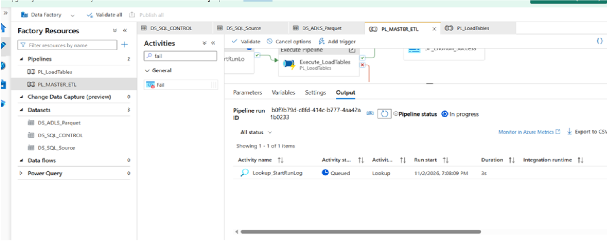
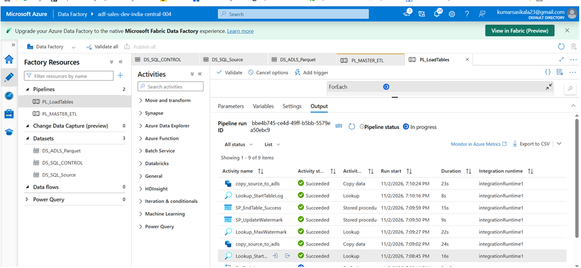
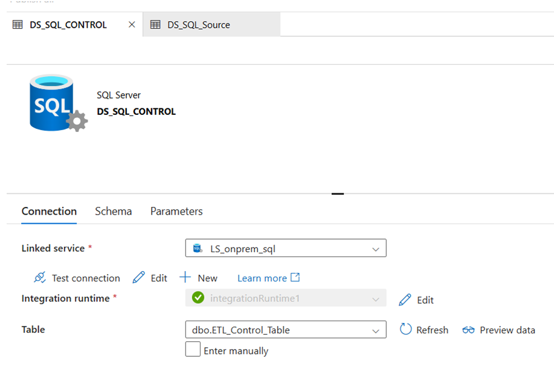
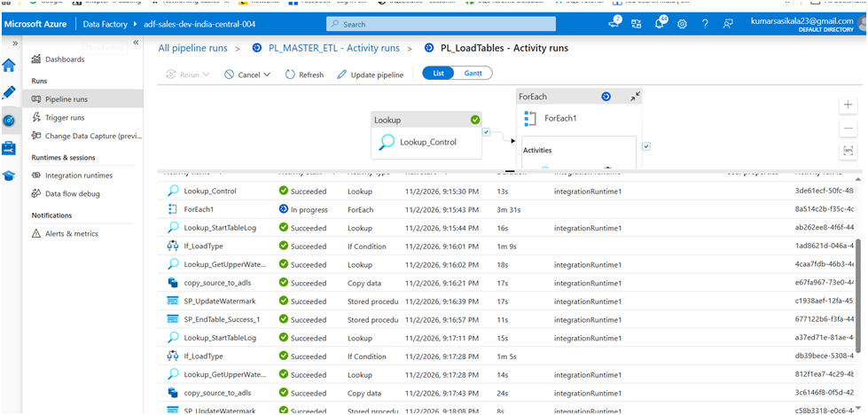

# Azure Data Factory – Pipeline Implementation

## 1. Overview

This section explains the Azure Data Factory pipelines developed for ingesting data from on-premises SQL Server into Azure Data Lake Storage Gen2 (ADLS Gen2).

The solution follows a metadata-driven approach using master and child pipelines to support reusable, parameterized, and incremental data ingestion.

## 2. Pipeline Architecture

The project contains two main pipelines:

### A. Master Pipeline – PL_Master_ETL

**Purpose:** Orchestrates the complete ETL process by reading active source tables and executing child pipelines.

**Activities:**

1. **Lookup_StartRunLog**
   - Executes `dbo.usp_StartPipelineLog`.
   - Creates a pipeline-level execution log.
   - Captures the requested-by value and execution details.

2. **Lookup_Control**
   - Retrieves active tables from the control table.
   - SQL query:

```sql
SELECT *
FROM dbo.ETL_Control_Table
WHERE IsActive = 1;
```

3. **ForEach_Tables**
   - Iterates through the active source tables.
   - Uses the Lookup output as its input.

```text
@activity('Lookup_Control').output.value
```

4. **Execute Pipeline**
   - Invokes the child pipeline `PL_LoadTables`.
   - Passes the table metadata and RunLogID.

### B. Child Pipeline – PL_LoadTables

**Purpose:** Performs table-level data ingestion from SQL Server to ADLS Gen2.

**Activities:**

1. Receives pipeline parameters.
2. Reads source table and watermark details.
3. Builds a dynamic source query.
4. Executes Copy Activity.
5. Loads data into ADLS Gen2.
6. Records table-level execution status.
7. Updates the watermark after successful processing.

## 3. Pipeline Parameters

### Master Pipeline – PL_Master_ETL

| Parameter | Type | Description |
|---|---|---|
| p_RunRequestedBy | String | Identifies who initiated the pipeline |
 
Default value: `ManualOperator`

### Child Pipeline – PL_LoadTables

| Parameter | Type | Description |
|---|---|---|
| p_RunLogID | Int | Identifies the master pipeline execution |
| SourceSchema | String | Source database schema |
| SourceTable | String | Source table name |
| WatermarkColumn | String | Column used for incremental extraction |
| LastWatermarkValue | String | Previously processed watermark |

*Adjust the child parameter names to match your actual implementation.*

## 4. Copy Activity Configuration

**Source:**
- Source system: On-premises SQL Server.
- Connectivity: Self-Hosted Integration Runtime.
- Extraction: Dynamic SQL query.
- Load type: Full or incremental.

**Sink:**
- Destination: ADLS Gen2.
- Container: Raw.
- Format: CSV or Parquet, depending on configuration.
- Folder path: Organized by source table.

## 5. Incremental Load Logic

The solution uses a watermark column to identify newly inserted or updated records.

Example:

```sql
SELECT *
FROM dbo.Customers
WHERE ModifiedDate > @LastWatermarkValue;
```

Processing steps:

1. Retrieve the previous watermark.
2. Extract records with a greater watermark value.
3. Copy records to ADLS Gen2.
4. Validate the extracted data.
5. Update the watermark only after successful processing.

## 6. Logging and Error Handling

The solution maintains two levels of execution logging.

**Pipeline-level logging**
- RunLogID
- Pipeline name
- Start time
- End time
- Run status
- Requested by

**Table-level logging**
- TableLogID
- RunLogID
- Source table
- Load type
- Start time
- End time
- Load status
- Error details

Failures are investigated through ADF Monitor and SQL execution logs. Watermark updates are restricted to successful loads.

## 7. Pipeline Execution Flow

```text
PL_Master_ETL
     |
     v
Lookup_StartRunLog
     |
     v
Lookup_Control
     |
     v
ForEach_Tables
     |
     v
Execute PL_LoadTables
     |
     v
Read Watermark
     |
     v
Copy Activity
     |
     v
ADLS Gen2
     |
     v
Validate Data
     |
     v
Update Watermark
     |
     v
Update Execution Logs
```

## 8. Screenshots

Add your actual Azure Data Factory screenshots below.

### Master Pipeline



### Child Pipeline



### Lookup Control Table



### ForEach Activity


### Copy Activity


### Successful Pipeline Execution



## 9. Key Implementation Highlights

- Built reusable master and child pipelines.
- Implemented metadata-driven table ingestion.
- Configured parameterized source and sink datasets.
- Implemented watermark-based incremental extraction.
- Integrated stored procedures for execution logging.
- Configured Self-Hosted Integration Runtime for on-premises connectivity.
- Implemented pipeline monitoring and failure troubleshooting.

## 10. Outcome

Developed a reusable Azure Data Factory ingestion framework to transfer data from on-premises SQL Server to ADLS Gen2 with metadata-driven orchestration, incremental loading, and execution monitoring.
